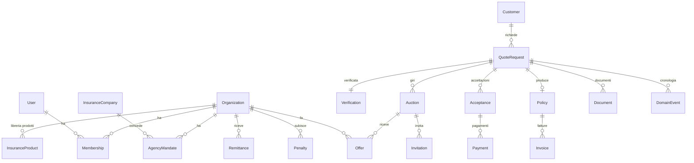
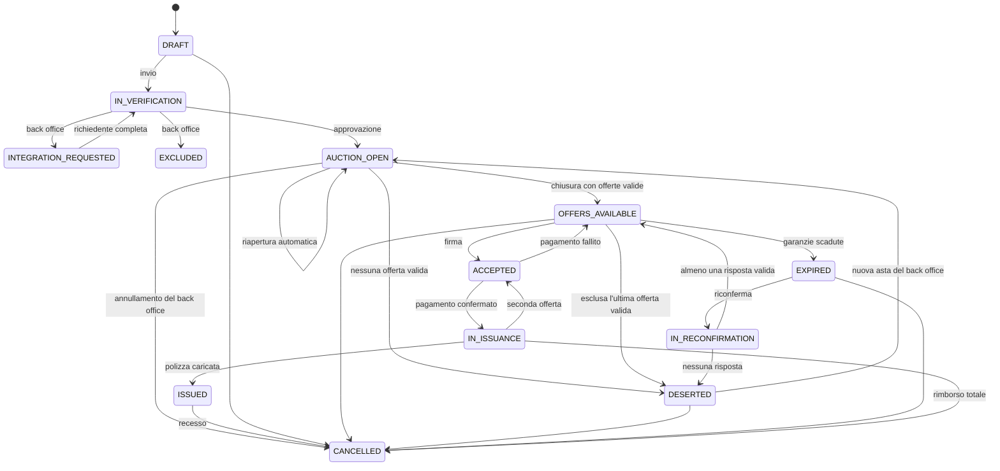
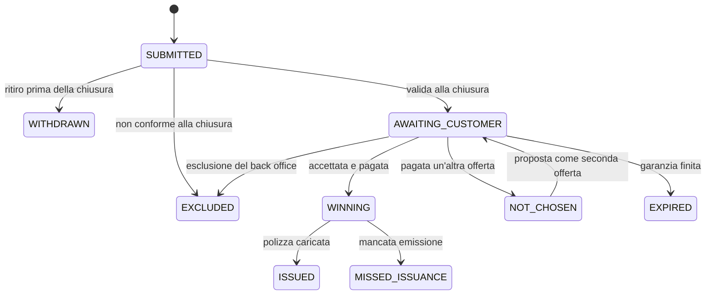

# Modello dati

Questo è il modello concettuale: entità, campi principali, stati e relazioni. Lo schema Prisma si costruisce fase per fase (colonna «Fase»): ogni fase aggiunge solo ciò che le serve, con migrazioni versionate. Nomi in inglese, come nel [glossario](glossario.md).

## Convenzioni

- Chiavi primarie UUID v7 generate dall'applicazione; codici leggibili a parte (`AX-2026-000123`).
- Ogni tabella ha `createdAt` e `updatedAt` in UTC. Le date senza ora (decorrenza, garanzia, nascita) sono `date` e si interpretano nel fuso di Roma.
- Denaro: interi in centesimi con suffisso `Cents`. Massimali e capitali: interi in euro con suffisso `Eur` (FEE-07).
- Campi cifrati (SIC-03): suffisso `Enc` (testo cifrato) più `...Hash` per l'indice cieco quando serve la ricerca esatta.
- Niente cancellazioni logiche generiche: gli stati dicono se un record è attivo. Le cancellazioni previste dalla conservazione (LEG-06) sono vere cancellazioni, registrate.
- Ogni cambio di stato scrive un `DomainEvent` e un `OutboxEvent` nella stessa transazione.
- Tabelle per organizzazione: colonna `organizationId` e politica di sicurezza a livello di riga (SIC-02).

## Mappa delle entità



## Identità e organizzazioni (fase 1)

| Entità | Campi principali | Note |
| --- | --- | --- |
| `User` | `keycloakId`, `kind` (`PRIVATE`, `PROFESSIONAL`, `STAFF`), `firstName`, `lastName`, `emailEnc`/`emailHash`, `phoneEnc`/`phoneHash`, `status` (`ACTIVE`, `SUSPENDED`, `BLOCKED`), `personId` | Una persona può avere più appartenenze |
| `Organization` | `type` (`AGENCY`, `BROKER`, `ASTAX`), `legalName`, `vatNumber`, `fiscalCodeEnc`/`Hash`, `ruiNumber`, `ruiSection` (`A`, `B`), `pec`, `address`, `ibanEnc`, `status` (`PENDING`, `ACTIVE`, `SUSPENDED`, `EXCLUDED`), `statusReason`, `profInsuranceExpiresOn` | AstAx stessa è un'organizzazione `ASTAX` |
| `Membership` | `userId`, `organizationId`, `role`, `ruiNumberE`, `ruiVerifiedAt`, `canIssue`, `canSeeColleagueOffers`, `canSeeAccounting`, `seesAllClients`, `status` | Il contesto attivo è una `Membership` |
| `TeamInvite` | `organizationId`, `emailHash`, `role`, `tokenHash`, `expiresAt`, `acceptedAt` | Invito a entrare nel team; diverso da `Invitation`, l'invito all'asta |
| `LegalDocument`, `LegalDocumentVersion` | `key`, `audience`, `channel`; versione: `number`, `contentMd`, `status` (`DRAFT`, `VALIDATED`), `validatedBy`, `publishedAt` | LEG-01, LEG-03 |
| `LegalAcceptance` | `userId` o `customerId`, `versionId`, `acceptedAt`, `ip`, `userAgent`, `method` (`CLICK`, `OTP`, `FEA`, `UPLOAD_BY_BROKER`) | — |
| `Setting` | `key`, `value` (JSON), `version`, `validFrom`, `changedBy`, `reason` | Storico completo; lettura per data |
| `ListValue` | `listKey`, `code`, `labelIt`, `labelSq`, `active`, `sortOrder` | Elenchi modificabili |
| `Holiday` | `date`, `name` | Festività nazionali |
| `AuditLog` | `at`, `actorUserId`, `actorMembershipId`, `actorOrganizationId`, `action`, `targetType`, `targetId`, `before`, `after`, `reason`, `ip`, `userAgent`, `prevHash`, `hash` | Solo aggiunta (SIC-04) |
| `DomainEvent` | `aggregateType`, `aggregateId`, `type`, `at`, `actor`, `data` | Cronologia visibile |
| `OutboxEvent` | `type`, `payload` (solo identificativi), `status`, `attempts`, `nextAttemptAt` | Consegna affidabile |

## Compagnie e agenzie (fasi 3-4)

| Entità | Campi principali | Note |
| --- | --- | --- |
| `InsuranceCompany` | `name`, `ivassCode`, `group`, `active` | Nei dati di prova solo nomi inventati |
| `CompanyComplaintsIndex` | `companyId`, `year`, `value`, `source` | Indice reclami IVASS, inserito dal back office |
| `AgencyMandate` | `organizationId`, `companyId`, `verifiedAt`, `source` (`RUI`, `MANUAL`) | Solo queste compagnie nelle offerte |
| `InsuranceProduct` | `organizationId`, `companyId`, `name`, `version`, documenti `PRODUCT_INFO` | Libreria prodotti (decisione 17) |
| `AgencyFilter` | `organizationId`, `criteria` (JSON), `updatedBy` | Vedi «Filtri» sotto |
| `MemberFilter` | `membershipId`, `criteria` (JSON) | Deve stare dentro `AgencyFilter` |
| `AgencyCapacity` | `organizationId`, `dailyMax`, `receptionHours` (JSON), `pausedUntil`, `distribution` (`ALL_USERS`, `BY_MEMBER_FILTERS`) | — |
| `RuiRecord` | `number`, `section`, `name`, `fiscalCodeHash`, `linkedNumber`, `importedAt` | Import dagli elenchi IVASS |

Filtri (`criteria`): `vehicleTypes[]`, `provinces[]` o tutte, `cuClassMin`, `cuClassMax`, `maxClaimsLast5y`, `driverAgeMin`, `driverAgeMax`, `packages[]`, `companies[]` (compagnie con cui l'agenzia intende offrire), `maxStartDateDays`, `maxGuaranteeDays`.

## Clienti e richieste (fase 2)

| Entità | Campi principali | Note |
| --- | --- | --- |
| `Customer` | `ownerUserId` (privato) o `ownerOrganizationId` + `ownerMembershipId` (broker), `personId`, `emailEnc`/`Hash`, `phoneEnc`/`Hash`, `contactsVerifiedAt` | I contatti stanno solo qui |
| `Person` | `kind` (`PERSON`, `COMPANY`), nomi o ragione sociale, `fiscalCodeEnc`/`Hash` o `vatNumber`, `birthDate`, `birthPlaceIstat`, `sex`, `residence` (via, CAP, comune ISTAT, provincia), `profession`, `maritalStatus`, `children` | Riutilizzabile tra richieste |
| `Vehicle` | `customerId`, `plate`, dati tecnici | Salvato per le richieste successive |
| `QuoteRequest` | `code`, `channel`, `requesterUserId`/`requesterMembershipId`, `customerId`, `status`, `quoteData` (JSON versionato), colonne derivate per i filtri, `startMode` (`DATE`, `ON_ISSUANCE`, `MIDNIGHT_AFTER_DEADLINE`, domanda 1), `chosenCoverages` (pacchetto `CUSTOM`: le garanzie scelte dal cliente), `aiComparisonUsed`, `reconfirmationsUsed`, `submittedAt`, `renewalOfPolicyId` | `quoteData` si congela all'invio |
| `Consent` | `customerId`, `type`, `legalVersionId`, `acceptedAt`, `method`, `evidence`, `revokedAt` | LEG-04 |
| `Document` | `kind`, `ownerType`, `ownerId`, `storageKey`, `sha256`, `mime`, `size`, `encryption` (`SSE_KMS`, `SEALED`), `uploadedBy`, `extraction` (JSON con confidenza per campo), `retainUntil` | — |
| `Verification` | `quoteRequestId`, `autoOutcome` (`GREEN`, `YELLOW`, `RED`), `checklist` (JSON: voce, esito automatico, correzione, nota), `assignedTo`, `decision` (`APPROVED`, `INTEGRATION_REQUESTED`, `EXCLUDED`), `reason`, `decidedBy`, `decidedAt`, `excludedAgencies` (JSON con motivo) | — |
| `ExclusionRule` | `code`, `condition` (JSON), `blockingInWizard`, `messageIt`, `active` | ASTA-10 |
| `CoveragePackage`, `CoveragePackageVersion` | `code`, `name`; versione: `requirements` (JSON), `customerTextIt`, `validFrom` | La richiesta salva la versione usata |
| `RequestBatch` | `code` (LT-AAAA-NNNNNN), `ownerOrganizationId`, `requesterUserId`/`requesterMembershipId`, `fileName`, `rows` | Il lotto del broker da file Excel ([ADR 0014](adr/0014-lotti-dei-broker.md)); ogni riga è una `QuoteRequest` con `batchId`, `batchLine`, `policyExpiryDate`, `scheduledSubmitAt`, `documentsDueAt`, `documentsNotifiedAt`, `withoutDocuments` |

Aggiunte in fase 2 ([ADR 0007](adr/0007-dati-della-richiesta-cifrati.md)): `QuoteDataVersion` (versioni di `quoteData` cifrate, solo in aggiunta), `QuoteRequestEvent` (cronologia, solo in aggiunta), `ConsentLink` (link di consenso del broker al cliente), `OtpChallenge` (codici OTP salvati come impronta), `Notification` (avvisi in app, anticipata dalla fase 7). Ogni riga di clienti e richieste ha `ownerUserId` o `ownerOrganizationId` per la sicurezza a livello di riga.

Colonne derivate di `QuoteRequest` per la selezione delle agenzie: `vehicleType`, `province` (residenza del contraente), `cuClass`, `claimsLast5y`, `youngestDriverAge` (alla decorrenza), `packageCode`, `startDate`, `minValidityDays`.

Struttura di `quoteData` (schema Zod in `packages/shared`, `schemaVersion: 1`):

```ts
type QuoteData = {
  schemaVersion: 1;
  policyHolder: PersonData;
  vehicleOwner: PersonData | "SAME_AS_POLICY_HOLDER";
  drivers: { person: PersonData; isMain: boolean; licence: { category: string; number: string; issuedOn: string; expiresOn: string } }[];
  drivingFormula: "FREE" | "EXPERT" | "EXCLUSIVE";
  vehicle: {
    plate: string; type: string; use: string; make: string; model: string; version?: string; providerCode?: string;
    fuel: string; displacementCc?: number; powerKw: number; firstRegistrationDate: string; purchaseDate: string; isNew: boolean;
    marketValueEur?: number; satelliteAlarm?: boolean; nightParking?: string; annualKmBand?: string;
  };
  history: {
    provenance: string; cuClass?: number;
    claims: { year: number; mainResponsibility: number; sharedResponsibility: number }[];
    riskUniqueId?: string; currentInsurer?: string; currentExpiryDate?: string;
    familyRc?: { plate: string; relativeFiscalCode: string };
  };
  request: {
    packageCode: "BASE" | "PLUS" | "COMPLETE"; packageVersion: number; startDate: string; blackBox: boolean;
    paymentFrequency: "ANNUAL"; auctionDurationHours: number; minValidityDays: number; currentPremiumCents?: number;
  };
};
```

Telefono ed email non fanno parte di `quoteData`: le agenzie ricevono `quoteData` e i documenti, mai `Customer` (VIS-01).

## Asta e offerte (fasi 3-4)

| Entità | Campi principali | Note |
| --- | --- | --- |
| `Auction` | `quoteRequestId`, `kind` (`MAIN`, `REOPEN`, `RECONFIRMATION`), `round`, `status` (`OPEN`, `CLOSING`, `CLOSED`, `CANCELLED`), `openedAt`, `scheduledCloseAt`, `originalCloseAt`, `closedAt`, `minGuaranteeDate`, `settingsSnapshot` (JSON), `publicKey`, `wrappedPrivateKey`, `kmsKeyRef`, `extensions` (JSON con motivo) | Un record per giro |
| `Invitation` | `auctionId`, `organizationId`, `source` (`AUTO`, `TOP_UP`, `BACK_OFFICE`, `RENEWAL`, `REOPEN`, `RECONFIRMATION`), `invitedAt`, `firstViewedAt`, `status` (`INVITED`, `VIEWED`, `CLAIMED`, `OFFERED`, `DECLINED`), `declineReason` | — |
| `Claim` | `auctionId`, `organizationId`, `membershipId`, `personId`, `claimedAt`, `releasedAt`, `releasedBy` | Unico per (asta, agenzia) attivo e per (asta, persona) attivo |
| `Offer` | `auctionId`, `organizationId`, `membershipId`, `personId`, `status`, `submittedAt`, `version`, `sealedPayload`, `sealedPdfKey`, `sealedPdfDataKey`, `ownerCopy`, campi in chiaro dopo la chiusura (`annualGrossPremiumCents`, `companyId`, `productId`, `coverage` JSON, `guaranteeUntil`, `notes`, `pdfDocumentId`), `exclusionReason`, `reviewFlags` (JSON), `rank` | Prima della chiusura i campi in chiaro sono nulli (BC-02) |
| `OfferVersion` | `offerId`, `version`, `sealedPayload`, `createdAt` | Storico delle modifiche, sempre cifrato |
| `Ranking` | `quoteRequestId`, `auctionId`, `entries` (JSON: offerta, agenzia, posizione, premio), `validCount`, `publishedAt` | CLA-01 |
| `AiSuggestion` | `quoteRequestId`, `offerIds`, `weights`, `inputs`, `scores`, `recommendedOfferId`, `text`, `model`, `promptVersion`, `shownAt` | PRES-08 |

## Accettazione, pagamenti, polizze (fasi 5-6)

| Entità | Campi principali | Note |
| --- | --- | --- |
| `Acceptance` | `quoteRequestId`, `offerId`, `acceptedBy` (privato o link del broker), `feeCents`, `feeRuleApplied`, `status` (`PENDING_SIGNATURE`, `SIGNED`, `PAID`, `VOIDED`), `signatureEnvelopeId`, `signedAt` | Una nuova se cambia l'offerta |
| `SignatureEnvelope` | `provider`, `providerRef`, `documents`, `status` (`PENDING`, `SIGNED`, `REJECTED`, `EXPIRED`), `evidenceDocumentId` | — |
| `CustomerLink` | `quoteRequestId`, `offerIds`, `tokenHash`, `expiresAt`, `otpVerifiedAt`, `sentBy` | Link del broker al cliente |
| `Payment` | `acceptanceId`, `provider`, `providerRef`, `method` (`CARD`, `INSTANT_TRANSFER`), `premiumCents`, `feeCents`, `status` (`CREATED`, `AUTHORIZED`, `CAPTURED`, `FAILED`, `REFUNDED`, `PARTIALLY_REFUNDED`), `capturedAt`, `idempotencyKey` | — |
| `ProviderEvent` | `provider`, `eventId`, `type`, `receivedAt` | Avvisi (webhook) dei fornitori di firma e pagamento, elaborati una volta sola |
| `Refund` | `paymentId`, `amountCents`, `reason`, `requestedBy`, `approvedBy`, `status`, `executedAt` | PAG-05 |
| `Policy` | `quoteRequestId`, `offerId`, `organizationId`, `companyId`, `policyNumber`, `startDate`, `startsAt` (inizio esatto della copertura, domanda 1), `endDate`, `premiumCents`, `issuedAt`, `issuedByMembershipId`, `status` (`ACTIVE`, `EXPIRING`, `EXPIRED`, `WITHDRAWN`, `CANCELLED`), `autoRenewal` | — |
| `IssuanceProblem` | `quoteRequestId`, `type` (`DATA_MISMATCH`, `CANNOT_ISSUE`), `description`, `openedBy`, `fault` (`AGENCY`, `CUSTOMER`), `outcome` | EMI-04 |
| `Penalty` | `organizationId`, `type` (`LATE_ISSUANCE`, `MISSED_ISSUANCE`, `CIRCUMVENTION`), `amountCents`, `quoteRequestId`, `status` (`PROPOSED`, `APPLIED`, `CONTESTED`, `UPHELD`, `CANCELLED`), `contestText`, `decision`, `remittanceId` | EMI-05 |
| `Remittance` | `organizationId`, `periodStart`, `periodEnd`, `items` (JSON), `grossCents`, `feesCents`, `penaltiesCents`, `brokerSharesCents`, `netCents`, `status` (`DRAFT`, `READY`, `FILE_GENERATED`, `EXECUTED`), `sepaFileKey`, `executedAt` | CONT-01 |
| `Invoice` | `series`, `number`, `year`, `recipientType`, `recipientId`, `lines`, `totalCents`, `vatNature`, `legalReference`, `stampDutyCents`, `sdiStatus`, `sdiId`, `xmlKey`, `pdfKey` | CONT-03 |
| `CreditNote` | `invoiceId`, come `Invoice` | — |
| `BrokerCommission` | `policyId`, `organizationId`, `amountCents`, `status` (`ACCRUED`, `SETTLED`), `settledAt` | Spenta finché il parametro è 0 |
| `ConsumerWithdrawal` | `policyId`, `requestedAt`, `refundableCents`, `decidedBy`, `status` | Recesso |
| `PostSaleSurvey` | `policyId`, `sentAt`, `answers`, `contactedByOthers` | Alimenta le segnalazioni |
| `NextOfferProposal` | `quoteRequestId`, `kind` (`SECOND_OFFER`, `REPRICE`), `fromOfferId`, `toOfferId`, `premiumCents`, `feeCents`, `differenceCents`, `expiresAt`, `status` | EMI-04: la seconda offerta o il nuovo prezzo da confermare (fase 6) |
| `AgencySuspension` | `organizationId`, `reason`, `startedAt`, `confirmedAt`, `revokedAt` | EMI-06 (fase 6) |
| `RemittanceLine` | `remittanceId`, `kind` (`POLICY`, `BROKER_SHARE`, `CARRIED_OVER`, `RECOVERY`, `PENALTY`), `ref`, `requestedCents`, `appliedCents` | Le righe della rimessa al posto di `items` in JSON: così si sa quanto resta di ogni penale (fase 6) |
| `InvoiceCounter` | `series`, `year`, `last` | Numerazione senza buchi (fase 6); le note di credito sono fatture della serie N |

## Assistenza e controllo (fase 7)

| Entità | Campi principali | Note |
| --- | --- | --- |
| `Notification` | `userId`, `eventKey`, `channel`, `payload` (solo identificativi e testo reso), `status`, `sentAt`, `readAt` | — |
| `NotificationPreference` | `userId`, `eventKey`, `channels[]` | Gli avvisi con scadenza vanno sempre anche in push |
| `NotificationTemplate` | `eventKey`, `channel`, `locale`, `subject`, `body`, `version` | Caricati da `seed/notifiche.yaml` |
| `PushSubscription` | `userId`, `endpoint`, `keys`, `userAgent` | Web Push |
| `Complaint` | `protocol`, `receivedAt`, `complainant`, `subject`, `intermediary`, `status`, `dueAt`, `response`, `outcome` | Risposta entro 45 giorni |
| `Flag` | `type` (`CIRCUMVENTION`, `FRAUD`), `source`, `quoteRequestId`, `organizationId`, `status`, `outcome` | — |
| `DataSubjectRequest` | `customerId`, `type` (`ACCESS`, `RECTIFICATION`, `ERASURE`), `receivedAt`, `dueAt`, `status` | — |
| `BankStatementLine` | `bookedAt`, `amountCents`, `reference`, `matchedPaymentId`, `status` | Riconciliazione assistita |

## Stati della richiesta



| Codice | Stato nell'interfaccia |
| --- | --- |
| `DRAFT` | Bozza |
| `IN_VERIFICATION` | In verifica |
| `INTEGRATION_REQUESTED` | Integrazione richiesta |
| `EXCLUDED` | Esclusa |
| `AUCTION_OPEN` | Asta aperta |
| `OFFERS_AVAILABLE` | Offerte disponibili |
| `DESERTED` | Deserta |
| `EXPIRED` | Scaduta |
| `IN_RECONFIRMATION` | In riconferma |
| `ACCEPTED` | Accettata |
| `IN_ISSUANCE` | In emissione |
| `ISSUED` | Emessa |
| `CANCELLED` | Annullata |

Ogni transizione passa da un'unica funzione di dominio (`transition(request, event)`) che rifiuta i passaggi non previsti. Il diagramma è la fonte: un test controlla che la tabella delle transizioni nel codice coincida.

## Stati dell'offerta



| Codice | Stato nell'interfaccia |
| --- | --- |
| `SUBMITTED` | Inviata |
| `WITHDRAWN` | Ritirata |
| `EXCLUDED` | Esclusa |
| `AWAITING_CUSTOMER` | In attesa del cliente |
| `WINNING` | Vincente |
| `ISSUED` | Emessa |
| `NOT_CHOSEN` | Non scelta |
| `EXPIRED` | Scaduta |
| `MISSED_ISSUANCE` | Mancata emissione (decisione aggiunta 31) |

Dopo una mancata emissione (EMI-04) la seconda offerta, se ancora garantita, torna da `NOT_CHOSEN` ad `AWAITING_CUSTOMER`; diventa `WINNING` quando il cliente conferma e il pagamento è regolato.

## Indici e vincoli da non dimenticare

- Unicità di `Offer` attiva per (`auctionId`, `organizationId`) e per (`auctionId`, `personId`): OFF-01, OFF-02.
- Unicità di `Claim` attiva per (`auctionId`, `organizationId`) e per (`auctionId`, `personId`): OFF-03.
- `AuditLog`: nessun permesso di `UPDATE` o `DELETE` per l'utente applicativo; trigger che li rifiuta comunque.
- `Invoice`: unicità di (`series`, `year`, `number`), numerazione senza buchi in una transazione.
- `Payment.idempotencyKey` unico; i webhook dei fornitori si elaborano una volta sola.
- Indici sulle colonne derivate di `QuoteRequest` e GIN su `AgencyFilter.criteria`.
