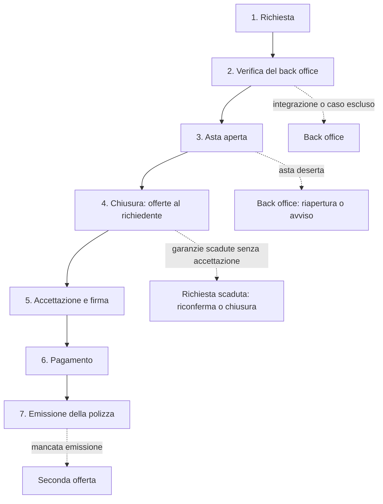

# AstAx — asta preventivi RCA: specifiche per ruoli e processi

14 ottobre 2026 · Damiano Qemali

## Principi generali

La piattaforma è gestita da AstAx, una nuova società indipendente da GD Brokers. Il software è un progetto nuovo, senza integrazioni con sistemi di GD. AstAx deve essere iscritta al RUI come broker (sez. B) ed è l'intermediario proponente di ogni polizza. L'agenzia che vince l'asta è l'intermediario emittente, in collaborazione orizzontale con AstAx.

Regole fisse, valide per tutti i ruoli:

- **Busta chiusa.** Nessuno vede i prezzi prima della chiusura, nemmeno back office e amministratore. Il vincolo è nel codice, non solo nel contratto.
- **Dati.** Con il consenso del cliente, le agenzie invitate vedono tutti i dati utili al preventivo. Telefono ed email vanno solo al vincitore.
- **Un'offerta per agenzia.** Ogni agenzia fa al massimo un'offerta per richiesta, chiunque dei suoi utenti la inserisca.
- **Offerta vincolante.** È calcolata sui dati completi, quindi dopo la chiusura non si ritira e vale fino alla data di prezzo garantito indicata dall'agenzia.
- **Pacchetti standard.** Le offerte si confrontano solo a parità di pacchetto di copertura.
- **Trasparenza finale.** Quando il cliente accetta un'offerta, ogni agenzia partecipante vede le prime due offerte, anonime, e la posizione della propria (per esempio quinta su otto).
- **Offerte solo da intermediari A o B.** I collaboratori sez. E operano sempre a nome del proprio intermediario.

### Ruoli in sintesi

| Ruolo | Chi è | Contratto con AstAx | Dati del cliente che vede |
| --- | --- | --- | --- |
| Broker richiedente | Broker sez. B che chiede preventivi per i propri clienti | Collaborazione, condizioni d'uso, accordo privacy | Solo i propri clienti |
| Cliente privato | Consumatore che chiede un preventivo | Incarico ad AstAx, condizioni d'uso, consenso privacy | I propri dati |
| Agenzia | Agente sez. A con mandati RCA | Collaborazione orizzontale A-B, condizioni d'uso, accordo privacy | Dati del preventivo; contatti solo se vince |
| Sub-agente | Collaboratore sez. E di un'agenzia | Nessuno diretto: accetta condizioni d'uso e riservatezza | Come l'agenzia, entro i propri filtri |
| Back office | Personale di AstAx | Lavoro o servizio, autorizzazione al trattamento | Tutto, tranne le offerte prima della chiusura |
| Amministratore | Titolare della piattaforma (AstAx) | Nessuno: AstAx è titolare del trattamento | Tutto, tranne le offerte prima della chiusura |

Schermate e funzioni di ogni utenza, in dettaglio: [Utenze: elementi comuni](01-utenze-elementi-comuni.md) e le schede dei ruoli (file da 02 a 07).

Scelte tecniche, API e servizi esterni: [Architettura tecnica](08-architettura-tecnica.md).

### Modello economico

Fee fisso lato cliente privato di 30 € a polizza, 35 € se usa il confronto con AI, riservato ai privati. Nel canale broker è il broker a pagare ad AstAx 30 € a polizza, come compenso di intermediazione esente IVA; fee fisso lato agenzia di 15 € a polizza emessa, trattenuto dalla rimessa. Il cliente paga il fee solo quando acquista, insieme al premio, con fattura separata. Il fee al cliente va dichiarato nell'informativa precontrattuale. Le fatture per servizi di intermediazione assicurativa sono esenti IVA (art. 10 DPR 633/72). Tutti i fee sono compensi di intermediazione esenti IVA, compreso il fee unico di 35 € con il confronto AI, che fa parte del servizio; nei contratti e nelle informative vanno descritti così. Resta da definire il fee sui premi bassi: vedi Punti aperti.

## Ruolo 1 — Broker richiedente

Il broker richiedente usa la piattaforma come fonte di preventivi per i propri clienti: invia le richieste, sceglie l'offerta e la propone al cliente.

### Struttura utenza

- Account aziendale intestato al broker (persona fisica o società sez. B), verificato sul RUI all'ingresso.
- **Titolare:** gestisce utenti, contratto, fatture e impostazioni.
- **Operatori:** collaboratori sez. E o dipendenti del broker; creano e seguono le richieste.

### Funzionalità

- Richiesta singola o caricamento in blocco (file con più veicoli e relativi documenti).
- Anagrafica dei propri clienti, con storico di richieste e polizze.
- Scelta di pacchetto, decorrenza, durata dell'asta e validità minima del prezzo.
- Monitoraggio delle aste: stato, tempo residuo, numero di offerte.
- Confronto delle offerte e invio al cliente di un link di accettazione e pagamento.
- Scadenzario dei rinnovi, con nuova asta proposta 30 giorni prima.
- Estratto conto: polizze emesse, provvigioni maturate, fatture.

### Cosa vede

- Solo i propri clienti e le proprie richieste.
- Durante l'asta: numero di offerte e tempo residuo, non i prezzi.
- Dopo la chiusura: la migliore offerta di ogni compagnia, con prezzo, coperture, preventivo PDF e data di prezzo garantito.
- Dopo l'accettazione: l'agenzia emittente, che compare anche nei documenti precontrattuali.

### Contratto con AstAx

- Accordo di collaborazione con AstAx, con la divisione delle provvigioni tra broker richiedente, AstAx e agenzia emittente, e il compenso di intermediazione di 30 € a polizza, esente IVA, che il broker paga ad AstAx.
- Condizioni d'uso della piattaforma, con la clausola di non aggiramento.
- Accordo sul trattamento dei dati: il broker resta titolare dei dati dei propri clienti, i ruoli di AstAx e delle agenzie vanno definiti per iscritto.

Attenzione: qui collaborano tre intermediari (broker richiedente, AstAx, agenzia). La collaborazione a tre è un tema dibattuto: va validata con il legale prima di aprire la piattaforma ai broker esterni.

## Ruolo 2 — Cliente privato

Il privato carica i documenti, sceglie copertura e durata dell'asta, poi accetta un'offerta, firma e paga in app.

### Struttura utenza

- Account personale con email e telefono, accesso con codice OTP.
- Più veicoli e più conducenti nello stesso account (per esempio la famiglia).
- Identità verificata con i documenti caricati e con l'attestato ANIA.

### Funzionalità

- Richiesta guidata: foto di libretto, patente e codice fiscale, con lettura automatica dei dati.
- Scelta del pacchetto standard (per esempio Base, Base più furto e incendio, Completa) e della decorrenza.
- Durata dell'asta: 1, 2, 5 o 24 ore, minimo 1 ora; validità minima del prezzo, per esempio 7, 15 o 30 giorni.
- Consenso specifico alla condivisione dei dati con le agenzie invitate.
- Notifiche: asta aperta, offerte arrivate, chiusura, polizza emessa.
- Confronto delle offerte, confronto con AI facoltativo, accettazione.
- Firma elettronica (FEA con OTP) di incarico, informativa precontrattuale e documenti di polizza.
- Pagamento con carta o bonifico istantaneo.
- Area documenti: polizza, quietanza, certificato, fatture.
- Rinnovo: 30 giorni prima della scadenza, proposta di nuova asta con i dati già salvati.
- Assistenza e reclami.

### Cosa vede

- Durante l'asta: tempo residuo e numero di offerte, non i prezzi.
- Dopo la chiusura: la migliore offerta di ogni compagnia, ordinate per prezzo, con coperture, preventivo PDF e data di prezzo garantito; la più bassa è evidenziata. Con il pulsante «Confronta con AI» vede anche la migliore per qualità/prezzo, con la spiegazione.
- Dopo l'accettazione: nome e contatti dell'agenzia emittente e stato dell'emissione.

### Contratto con AstAx

- Incarico ad AstAx come broker (lettera di incarico).
- Condizioni d'uso per consumatori, con gli obblighi della vendita a distanza, recesso compreso.
- Informativa privacy e consenso specifico alla condivisione dei dati con le agenzie invitate.
- Informativa precontrattuale (MUP, Provv. IVASS 147/2024): AstAx proponente, agenzia emittente, compagnia, compensi, modalità di pagamento.
- Fee lato cliente di 30 € (35 € con il confronto AI), esente IVA, indicato nell'informativa precontrattuale e fatturato a parte.

## Ruolo 3 — Agenzia (sez. A)

L'agenzia è l'intermediario emittente: fa l'offerta, emette la polizza con le proprie compagnie e risponde dei propri collaboratori.

### Struttura utenza

- Account aziendale intestato all'agenzia (persona fisica o società sez. A).
- **Titolare:** contratto, utenti, IBAN, fatture e statistiche di tutta l'agenzia.
- **Supervisore** (facoltativo): vede e gestisce le offerte di tutti gli utenti dell'agenzia.
- **Utenti operativi:** sub-agenti e altri collaboratori sez. E collegati all'agenzia.

### Funzionalità

- Ingresso: verifica RUI, compagnie mandanti, RC professionale, IBAN, firma digitale del pacchetto contrattuale.
- Gestione utenti: invito dei sub-agenti, permessi, disattivazione.
- Filtri di agenzia: veicolo, guidatore, classe CU, sinistri, province, pacchetti, compagnie; massimo di richieste al giorno.
- Notifiche push, email o WhatsApp solo per le richieste in target.
- Bacheca richieste: presa in carico, offerta, rinuncia («non interessato»).
- Offerta: premio lordo annuo, compagnia, pacchetto, franchigie, data di prezzo garantito, preventivo PDF.
- Emissione: caricamento di polizza, quietanza e documenti entro il termine fissato.
- Estratto conto: premi incassati da AstAx, fee trattenuti, rimesse, fatture.
- Statistiche: richieste viste, offerte fatte, aste vinte, distanza media dal vincitore.

### Cosa vede

- Richieste in target con tutti i dati utili al preventivo: veicolo, guidatore, attestato, documenti.
- Telefono ed email del cliente solo se vince.
- Durante l'asta: solo la propria offerta.
- Dall'accettazione del cliente: le prime due offerte, anonime, e la posizione della propria.
- Non vede: nomi e compagnie delle altre agenzie, richieste fuori dai propri filtri.

### Contratto con AstAx

- **Accordo di collaborazione orizzontale A-B:** AstAx proponente, agenzia emittente; ripartizione di provvigioni e fee; incasso e rimesse; responsabilità; durata e recesso.
- **Condizioni d'uso:** regole d'asta, obbligo di emettere al prezzo offerto, tempi, penali, sospensione ed esclusione.
- **Non aggiramento:** divieto di contattare clienti visti in piattaforma senza aver vinto, con penale superiore alla provvigione di una polizza.
- **Accordo privacy:** in fase d'asta l'agenzia tratta i dati per conto di AstAx (responsabile, art. 28 GDPR); dopo l'emissione diventa titolare autonoma per il contratto. Da validare.
- **Dichiarazione di responsabilità** per l'operato dei propri collaboratori sez. E.

## Ruolo 4 — Sub-agente (sez. E)

Il sub-agente lavora in piattaforma come utente dell'agenzia: vede le richieste, fa offerte ed emette, sempre a nome dell'agenzia.

### Struttura utenza

- Utente collegato a un solo account agenzia: senza agenzia non esiste.
- Iscrizione in sez. E verificata sul RUI come collaboratore di quell'agenzia.
- Accesso personale con autenticazione a due fattori.
- Se collabora con più agenzie: un utente per ciascuna, con contesti separati.

### Funzionalità

- Filtri personali, dentro i filtri dell'agenzia.
- Bacheca delle richieste in target e presa in carico.
- Offerta a nome dell'agenzia.
- Emissione, se il titolare gli dà il permesso.
- Statistiche personali.

### Cosa vede

- Le richieste nei propri filtri e le proprie offerte.
- Le offerte dei colleghi della stessa agenzia solo se il titolare lo abilita.
- Non vede i dati economici dell'agenzia, salvo permesso, né le offerte di altre agenzie.

Regola: una sola offerta per agenzia per richiesta. La prima presa in carico blocca la richiesta per gli altri utenti della stessa agenzia.

### Contratto con AstAx

- Nessun contratto diretto: il rapporto passa dall'agenzia, che risponde del suo operato.
- Al primo accesso accetta condizioni d'uso, impegno di riservatezza e clausola di non aggiramento.
- La divisione delle provvigioni con l'agenzia resta un accordo interno tra loro.

## Ruolo 5 — Back office

Il back office verifica ogni richiesta prima dell'asta, gestisce le eccezioni e chiude il ciclo dei pagamenti.

### Struttura utenza

Utenti interni di AstAx, con ruoli separati:

- **Operatore verifica:** controlla le richieste e apre le aste.
- **Assistenza:** risponde a clienti, broker e agenzie.
- **Contabilità:** incassi, rimesse, fatture.
- **Supervisore:** eccezioni, segnalazioni, reclami.

### Funzionalità

- Coda di verifica con checklist: attestato ANIA, veicolo, documenti, residenza, decorrenza, consenso, casi esclusi.
- Esito della verifica: approva e apre l'asta, chiede integrazioni, oppure esclude e colloca direttamente.
- Aste deserte e mancate emissioni: collocamento diretto o passaggio alla seconda offerta.
- Approvazione delle nuove agenzie dopo i controlli automatici.
- Riconciliazione degli incassi, rimesse settimanali, fatture via SDI.
- Segnalazioni di aggiramento: verifica sul registro accessi, proposta di penale o esclusione.
- Registro reclami e risposte nei termini.

### Cosa vede

- Tutte le richieste, i documenti, gli stati delle aste e i flussi di pagamento.
- Non vede i prezzi delle offerte prima della chiusura: vincolo tecnico, valido per tutti.
- Ogni suo accesso ai dati del cliente viene registrato.

### Contratto

- Contratto di lavoro o di servizio con AstAx, o con la società esterna che le fornisce il back office (per esempio in Albania).
- Autorizzazione al trattamento dei dati e impegno di riservatezza.
- Iscrizione in sez. E per chi svolge attività di distribuzione a contatto con i clienti.
- L'Albania è fuori dall'UE: il trasferimento dei dati richiede garanzie adeguate, per esempio clausole contrattuali standard. Da verificare con il DPO.

## Ruolo 6 — Amministratore

L'amministratore governa le regole della piattaforma; non partecipa alle aste e non vede le offerte prima della chiusura.

### Struttura utenza

- Pochi utenti nominativi di AstAx, con autenticazione a due fattori obbligatoria.
- Ogni azione registrata in un log non modificabile.

### Funzionalità

- Regole d'asta: durate disponibili, orari, numero di agenzie invitate, finestre di accettazione ed emissione.
- Pacchetti di copertura standard e casi esclusi dall'asta.
- Percentuali dei fee e regole di ripartizione delle provvigioni.
- Ruoli e permessi di tutti gli utenti.
- Sospensione ed esclusione di agenzie e utenti, gestione delle penali.
- Versioni dei contratti, con il registro di chi ha accettato quale versione.
- Cruscotto: richieste, aste deserte, conversione, risparmio medio, tempi di emissione, partecipazione delle agenzie.
- Esportazioni per IVASS, Garante privacy e revisori.

### Cosa vede

Tutto, tranne i prezzi delle offerte prima della chiusura.

### Responsabilità di AstAx come titolare

- Iscrizione al RUI come broker (sez. B) prima di operare: responsabile della distribuzione e rappresentante legale iscritti in sez. B, RC professionale adeguata all'attività online e alle collaborazioni (vedi Punti aperti).
- Titolare del trattamento dei dati raccolti dalla piattaforma.
- Premi incassati su conto separato; in alternativa fideiussione bancaria pari al 4% dei premi incassati, con il minimo di legge ([art. 117 CAP](https://www.brocardi.it/codice-delle-assicurazioni-private/titolo-ix/capo-iii/art117.html)). Con 4 milioni di premi l'anno, la fideiussione sarebbe di circa 160 mila euro.
- Conflitto di interessi: se GD Brokers o altre società collegate usano la piattaforma, come richiedenti o come offerenti, lo fanno alle stesse condizioni degli altri e il legame viene dichiarato.

## Ciclo di vita dell'asta

Ogni richiesta segue sette passaggi, dalla richiesta alla polizza emessa; quattro eccezioni la deviano verso il back office o la chiudono.

_Diagramma ricostruito in Mermaid dal documento originale._

A sinistra il percorso normale, a destra le eccezioni: due tornano al back office, una chiude l'asta, una passa alla seconda offerta.

## Processo 1 — Apertura dell'asta

Un'asta si apre solo dopo la verifica del back office, e il tempo scelto dal cliente parte da quel momento.

1. **Richiesta.** Il privato o il broker carica documenti, sceglie pacchetto, decorrenza, durata dell'asta e validità minima del prezzo, e firma il consenso.
2. **Precompilazione automatica.** Lettura del libretto, dati del veicolo dalla targa, attestato da ANIA.
3. **Verifica del back office**, con questa checklist:
   - attestato ANIA: classe CU, sinistri degli ultimi 5 anni, scadenza della polizza attuale;
   - veicolo: modello, allestimento, kW, uso;
   - documenti coerenti: intestatario del libretto, patente valida, codice fiscale;
   - residenza dichiarata coerente con libretto e ANIA, per bloccare le residenze di comodo;
   - decorrenza realistica e consenso firmato;
   - casi esclusi dall'asta (veicoli d'epoca, noleggio, usi speciali): il cliente viene avvisato subito; il collocamento tramite un broker partner è un punto aperto.
4. **Esito della verifica:** approvata, integrazione richiesta al cliente, oppure esclusa.
5. **Selezione delle agenzie:** filtri compatibili, capacità disponibile, varietà di compagnie, rotazione tra agenzie simili; massimo N agenzie per richiesta.
6. **Apertura:** parte il conto alla rovescia, le agenzie invitate ricevono la notifica, il cliente riceve l'ora di chiusura.

Regola sugli orari: il tempo dell'asta scorre solo in orario lavorativo (per esempio 9-19, dal lunedì al sabato). Un'asta che finirebbe fuori orario chiude la mattina dopo.

Obiettivo: verifica automatica nell'80% dei casi; l'operatore interviene solo sulle anomalie segnalate.

## Processo 2 — Partecipazione

Ogni agenzia invitata fa al massimo un'offerta, vincolante, che resta segreta fino alla chiusura.

1. **Notifica e bacheca.** L'agenzia vede la richiesta con tutti i dati utili al preventivo, senza telefono ed email.
2. **Presa in carico.** Un utente dell'agenzia blocca la richiesta per i colleghi.
3. **Calcolo** sul portale della compagnia, con i dati completi.
4. **Inserimento dell'offerta:** premio lordo annuo (imposte e contributo SSN inclusi), compagnia, pacchetto, franchigie, data di prezzo garantito, preventivo PDF.
5. **Modifica o ritiro** possibili fino alla chiusura. Con la busta chiusa non danno vantaggi a nessuno.
6. **Rinuncia** con il tasto «non interessato» e un motivo facoltativo: serve a migliorare gli inviti futuri.

Regole dell'offerta:

- Deve rispettare il pacchetto richiesto, altrimenti viene esclusa alla chiusura.
- La data di prezzo garantito deve rispettare la validità minima richiesta.
- Ogni apertura dei dati del cliente viene registrata, con utente, data e ora.

## Processo 3 — Chiusura e accettazione

Alla scadenza il sistema blocca le offerte, le ordina per prezzo e le mostra al cliente, che può accettare finché l'offerta scelta è garantita.

1. **Chiusura automatica** all'ora fissata: dopo, nessuna offerta entra o cambia.
2. **Controllo di conformità:** escluse le offerte fuori pacchetto o senza preventivo PDF.
3. **Classifica** per premio lordo; a parità di prezzo vince la garanzia più lunga, poi l'offerta arrivata prima.
4. **Asta deserta** (nessuna offerta valida): si può riaprire l'asta con filtri più ampi, altrimenti il cliente viene avvisato. Il collocamento tramite un broker partner è un punto aperto.
5. **Presentazione al cliente:** la migliore offerta di ogni compagnia, ordinate per prezzo, ciascuna con la data di prezzo garantito. Solo per i privati, il pulsante «Confronta con AI» indica la migliore per qualità/prezzo e spiega perché; usarlo porta il fee da 30 € a 35 €.
6. **Accettazione:** il cliente sceglie liberamente; la più bassa e il suggerimento dell'AI sono evidenziati.
7. **Firma FEA** di incarico e documenti precontrattuali.
8. **Mancata accettazione** entro la scadenza delle garanzie: asta scaduta, le offerte decadono e le agenzie ricevono la notifica.

Durante questa fase ogni agenzia vede solo lo stato della propria offerta: valida, esclusa o in attesa del cliente. La classifica arriva quando il cliente accetta un'offerta.

### Prezzo garantito e riconferma

Ogni offerta ha una data di prezzo garantito: fino a quel giorno il richiedente può accettarla e l'agenzia emette al prezzo offerto, senza riaprire l'asta.

- **Validità minima richiesta.** Chi apre la richiesta sceglie per quanto deve valere il prezzo (per esempio 7, 15 o 30 giorni). Le offerte con garanzia più corta vengono escluse alla chiusura, così restano confrontabili.
- **Garanzia dell'agenzia.** L'agenzia indica la data fino a cui garantisce il prezzo, uguale o successiva al minimo richiesto.
- **Condizioni.** Il prezzo vale se la decorrenza resta quella richiesta e i dati del preventivo non cambiano: conducenti, residenza, veicolo, sinistri.
- **Cambio di tariffa della compagnia.** Durante la garanzia l'agenzia emette comunque al prezzo offerto: è ciò che rende il prezzo davvero garantito. Va scritto nelle condizioni d'uso (vedi Punti aperti).
- **Cosa vede il richiedente.** Accanto a ogni offerta la data di garanzia e i giorni rimasti; due giorni prima della scadenza riceve un promemoria.
- **Accettazione.** Vale la più bassa tra le offerte ancora garantite: se la prima è scaduta, passa in testa la successiva.
- **Riconferma.** Se tutte le offerte sono scadute, con un clic si chiede alle stesse agenzie di confermare o aggiornare il prezzo, per esempio entro 24 ore lavorative. Stessi partecipanti, stessi dati, busta chiusa: non è una nuova asta.
- **Lato agenzia.** In bacheca, una sezione «offerte aperte» con tutte le offerte ancora vincolanti e la loro scadenza.

## Processo 4 — Post-accettazione

Dopo l'accettazione il cliente paga AstAx, l'agenzia vincitrice riceve i contatti ed emette, AstAx rimette il premio e chiude la contabilità.

1. **Pagamento.** Il cliente paga il premio, più il fee se è un privato (30 € o 35 €), sul conto separato di AstAx, tramite il fornitore dei pagamenti. L'effetto liberatorio del pagamento ad AstAx è un punto aperto (vedi sotto).
2. **Assegnazione.** L'agenzia vincitrice riceve la conferma del pagamento, i dati completi e i contatti del cliente.
3. **Emissione.** Entro il termine fissato (per esempio 4 ore lavorative, comunque prima della decorrenza), l'agenzia emette sul portale della compagnia e carica polizza, quietanza e documenti.
4. **Consegna.** Il cliente trova i documenti nella sua area e riceve la notifica; la polizza viene registrata nell'archivio della piattaforma.
5. **Mancata emissione.**
   - Per colpa dell'agenzia: penale e passaggio alla seconda offerta. Il cliente conferma il nuovo prezzo o viene rimborsato.
   - Per dati errati del cliente: nuovo calcolo; il cliente accetta il nuovo prezzo o viene rimborsato.
6. **Rimessa.** AstAx trasferisce all'agenzia il premio meno il fee di 15 €, ogni settimana e comunque in tempo perché l'agenzia paghi la compagnia.
7. **Fatture.** Fee all'agenzia, al cliente privato e al broker richiedente, emesse in automatico via SDI.
8. **Classifica.** Visibile ai partecipanti già dall'accettazione: le prime due offerte, anonime, e la posizione della propria. Se la richiesta si chiude senza accettazione, compare alla chiusura.
9. **Post-vendita.** Assistenza dall'agenzia emittente; reclami tramite piattaforma e registro di AstAx; questionario al cliente, con la domanda «sei stato contattato da altri?».
10. **Rinnovo.** 30 giorni prima della scadenza, proposta di nuova asta con i dati salvati; l'agenzia attuale è invitata in automatico.
11. **Recesso o annullamento.** Rimborso con il flusso inverso (agenzia, AstAx, cliente); le regole sul fee sono da definire.

## Punti aperti

I primi sei punti sono decisioni di business; gli altri vanno chiusi con legale, DPO o amministrazione prima del lancio.

Per ogni punto c'è una proposta con un valore predefinito nella scheda [Decisioni e valori predefiniti](09-decisioni-e-valori-predefiniti.md).

| Punto | Questione | Chi decide |
| --- | --- | --- |
| Fee sui premi bassi | 30 € pesano molto su moto e ciclomotori: soglia di premio o fee ridotto | Decisione commerciale |
| Criteri del confronto con AI | Pesi di prezzo, franchigie e rivalsa, reclami della compagnia, tempi di emissione dell'agenzia | Decisione, poi test |
| Agenzie invitate per richiesta | Tutte quelle in target, oppure un massimo (per esempio 5-8) | Decisione, poi test |
| Finestre temporali | Durata minima, orari, validità minime proposte, emissione | Decisione operativa |
| Rischio tariffa durante la garanzia | Se la compagnia cambia tariffa prima della scadenza: l'agenzia emette comunque al prezzo offerto, oppure è un'eccezione ammessa | Decisione, da concordare con le prime agenzie |
| Aste deserte e casi esclusi | Solo avviso al cliente, oppure collocamento tramite un broker partner | Decisione commerciale |
| Iscrizione RUI di AstAx | Broker (sez. B) prima del lancio: sede in Italia, responsabile della distribuzione e rappresentante legale iscritti in sez. B, RC professionale ([art. 112 CAP](https://www.brocardi.it/codice-delle-assicurazioni-private/titolo-ix/capo-ii/art112.html)) | Legale e amministrazione |
| Confronto con AI e consulenza | Un suggerimento personalizzato può essere consulenza ai sensi dell'IDD: obbligo di spiegare perché e responsabilità di AstAx sul risultato | Legale |
| Effetto liberatorio del pagamento ad AstAx | Per un broker vale solo se previsto dall'accordo con l'impresa e comunicato al cliente ([art. 118 CAP](https://www.brocardi.it/codice-delle-assicurazioni-private/titolo-ix/capo-iii/art118.html)). Va definito come si applica nella collaborazione con l'agenzia emittente | Legale |
| Collaborazione a tre intermediari | Broker richiedente, AstAx e agenzia: ammessa o no, e con quale schema | Legale |
| Ruoli privacy | Titolare e responsabile per agenzie e broker, nelle diverse fasi | Legale e DPO |
| Dati in Albania | Garanzie per il trasferimento fuori UE, se il back office è in Albania | DPO |
| Vendita a distanza | Recesso, informative, tempi | Legale |
| Conto separato o fideiussione | Scelta in base ai premi incassati ([art. 117 CAP](https://www.brocardi.it/codice-delle-assicurazioni-private/titolo-ix/capo-iii/art117.html)) | Amministrazione |
| Fornitore dei pagamenti | Nexi, Stripe o Fabrick: chi accetta l'incasso di premi assicurativi | Verifica commerciale |
| Penali e non aggiramento | Importi e procedura di contestazione | Legale |
| Rapporti con GD Brokers | Se GD usa la piattaforma, come richiedente o come offerente: condizioni di mercato e legame dichiarato | Legale |

### Fonti

- [Art. 112 CAP — Requisiti per l'iscrizione delle società](https://www.brocardi.it/codice-delle-assicurazioni-private/titolo-ix/capo-ii/art112.html) (Brocardi)
- [Art. 117 CAP — Separazione patrimoniale](https://www.brocardi.it/codice-delle-assicurazioni-private/titolo-ix/capo-iii/art117.html) (Brocardi)
- [Art. 118 CAP — Adempimento delle obbligazioni pecuniarie attraverso intermediari](https://www.brocardi.it/codice-delle-assicurazioni-private/titolo-ix/capo-iii/art118.html) (Brocardi)
