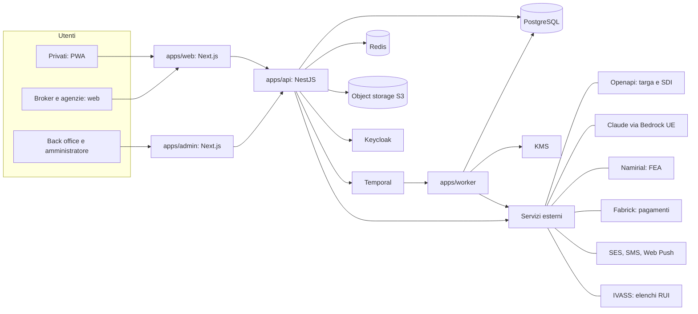

# Architettura tecnica

## Sintesi

La scelta consigliata è un'unica piattaforma web modulare in TypeScript, su un cloud con region in Italia. Un motore di workflow gestisce tutti i tempi delle aste, e i servizi specifici del mercato italiano arrivano via API: targa, documenti, firma, pagamenti, fatture.

- **Un solo backend modulare, non microservizi.** Con una squadra piccola si va in produzione prima; si separa più avanti solo ciò che lo richiede.
- **Una sola base di codice per il frontend.** Web app per professionisti e back office; app installabile (PWA) per i privati; app negli store solo in fase 2.
- **PostgreSQL come database unico**, Redis per code e cache.
- **Motore di workflow durevole** per aste, garanzie, promemoria e rinnovi: i timer sopravvivono a riavvii e aggiornamenti.
- **Busta chiusa garantita dalla crittografia**, non solo dai permessi: nessuno può leggere le offerte prima della chiusura.
- **Dati in Italia:** cloud con region a Milano o Torino e fornitori con contratto di trattamento dati.
- **Fornitori italiani per ciò che è tipico del mercato:** dati veicolo, firma FEA, incasso dei premi, fatturazione SDI.
- **Nessun accesso diretto alla banca dati degli attestati:** il cliente carica l'attestato, l'AI lo legge e l'agenzia lo verifica sul portale della compagnia.

## Architettura

_Diagramma ricostruito in Mermaid dal documento originale._

Gli utenti usano un'unica web app; il backend parla con i servizi esterni solo via API, e il motore di workflow gestisce tutti i tempi delle aste.

## Stack consigliato

Tutto in TypeScript, dal browser al server: un solo linguaggio riduce i costi della squadra e gli errori tra frontend e backend.

| Livello | Scelta consigliata | Alternativa | Perché |
| --- | --- | --- | --- |
| Frontend web | Next.js (React, TypeScript) | Nuxt, SvelteKit | Ecosistema ampio, pagine pubbliche indicizzabili, componenti condivisi tra le aree |
| App per i privati | PWA dalla stessa base di codice | React Native con Expo | Installabile, con notifiche push, senza un secondo progetto |
| Backend | Node.js con NestJS, monolite modulare | Python FastAPI, Java Spring | Stesso linguaggio del frontend, moduli separati per richieste, aste, pagamenti, documenti |
| API | REST documentate con OpenAPI; WebSocket per il tempo reale | GraphQL | Semplici da documentare e da aprire ai broker in fase 2 |
| Database | PostgreSQL gestito | — | Transazioni affidabili per offerte e pagamenti; JSONB per i filtri; sicurezza a livello di riga per separare le organizzazioni |
| Code e cache | Redis | — | Notifiche, limiti di frequenza, cache |
| Workflow e timer | Temporal (cloud UE o installato in proprio) | BullMQ su Redis | Timer durevoli, nuovi tentativi automatici, storico completo di ogni asta |
| File | Object storage compatibile S3, in UE e cifrato | — | Documenti, preventivi e polizze; link firmati a scadenza |
| Chiavi | Servizio KMS del cloud | HashiCorp Vault | Chiavi per la busta chiusa e per i campi sensibili |
| Autenticazione | Keycloak installato in proprio | Auth0, Clerk con region UE | Ruoli, organizzazioni con più utenti, 2FA, accesso con OTP per i privati |
| Back office | Pannello interno sullo stesso backend (React Admin o Refine) | Retool | Veloce da costruire, dati sempre in casa |
| Hosting | AWS Milano, Azure Italy North o Google Cloud Milano/Torino | Cloud italiani (Aruba, Seeweb) | Dati in Italia, database e servizi gestiti |
| Monitoraggio | Sentry, OpenTelemetry, Grafana | Datadog | Errori, tempi di risposta, allarmi |
| Analisi | PostHog (UE) e Metabase | — | Funnel e cruscotti senza dati fuori UE |

## Motore d'asta

Il cuore tecnico è il ciclo di vita dell'asta: ogni richiesta è un workflow con timer durevoli, e le offerte restano cifrate fino alla chiusura.

### Ciclo di vita come workflow

- Un workflow per richiesta: verifica, apertura, chiusura, accettazione, pagamento, emissione, classifica, rinnovo.
- Timer gestiti dal workflow: chiusura dell'asta, scadenze delle garanzie, promemoria a 2 giorni, termine di emissione, rinnovo a 30 giorni. Sopravvivono a riavvii e rilasci.
- Calendario lavorativo: l'ora di chiusura si calcola su orari e festività configurati dall'amministratore.
- Ogni cambio di stato è un evento registrato: da qui si costruiscono la cronologia mostrata agli utenti e i report.

### Busta chiusa crittografica

- All'apertura il sistema crea una chiave dedicata a quell'asta nel KMS.
- Ogni offerta viene cifrata con quella chiave appena arriva: nel database è illeggibile.
- Solo il workflow, alla chiusura, può usare la chiave per decifrare e ordinare. Nessun utente ha questo permesso, amministratori compresi.
- Il KMS registra ogni uso della chiave: è una prova verificabile, anche verso le agenzie, che nessuno ha visto le offerte prima della chiusura.

### Integrità e concorrenza

- Presa in carico con blocco nel database: una sola offerta per agenzia.
- L'ora che conta è quella del server, mai quella del browser: un'offerta arrivata dopo la chiusura viene rifiutata nella stessa transazione.
- Chiusura e invio di un'offerta non possono sovrapporsi.

### Selezione delle agenzie

- **MVP:** regole sui filtri delle agenzie, capacità giornaliera e rotazione tra agenzie simili.
- **Fase 2:** punteggio sullo storico (risposte e vittorie per tipo di profilo), per invitare chi ha più probabilità di offrire il prezzo migliore.

### Tempo reale

WebSocket, o un servizio gestito come Ably o Pusher, per contatori di offerte e cambi di stato; notifiche push per gli eventi importanti.

### Confronto qualità/prezzo con AI

- Punteggio calcolato con criteri fissi e pesi configurabili: prezzo, franchigie e rivalsa, reclami della compagnia in rapporto ai premi (dati pubblicati da IVASS, [esempio](https://www.gruppoitas.it/documents/20121/0/Comunicato%20stampa_19.11.25_Classifica%20reclami.pdf/d5cc4933-ed1e-eda1-3516-8ae835329eb2)), tempi di emissione dell'agenzia sulla piattaforma.
- Il modello AI non decide da solo: legge punteggio e documenti dell'offerta e scrive la spiegazione in linguaggio semplice.
- Ogni suggerimento viene salvato con criteri, dati usati e testo mostrato, per giustificarlo in caso di reclamo o controllo.
- Il cliente vede che il suggerimento è generato con AI e resta libero di scegliere. Il confronto è riservato ai clienti privati.
- Il fee fisso rende AstAx neutrale: non guadagna di più se il cliente sceglie una polizza più cara.

## Integrazioni esterne

Ogni integrazione passa da un modulo dedicato nel backend: se un fornitore cambia, si sostituisce il modulo senza toccare il resto. I fornitori indicati sono da confermare con una prova tecnica e un'offerta commerciale.

| Funzione | Opzioni | Consiglio | Note |
| --- | --- | --- | --- |
| Dati veicolo da targa | [Openapi Automotive](https://console.openapi.com/it/apis/automotive/documentation): dati tecnici e stato assicurativo; [InfoTarga](https://veicolo.app/en/data-api): anche idoneità neopatentati, revisioni, furti | Uno dei due, scelto dopo una prova su un campione di targhe reali | Precompila la richiesta e riduce gli errori |
| Attestato di rischio | Banca dati ANIA: la consultano le imprese e chi opera per loro conto ([Provv. IVASS 71/2018](https://www.dirittobancario.it/wp-content/uploads/sites/default/files/allegati/provvedimento_ivass_16_aprile_2018_n._71.pdf)) | Il cliente carica l'attestato, l'AI estrae classe e sinistri, l'agenzia lo verifica sul portale della compagnia | Il cliente lo trova nella sua area personale almeno 30 giorni prima della scadenza ([esempio](https://www.unicreditallianzassicurazioni.it/content/dam/onemarketing/azit/unicreditallianzassicurazioni-it/news/informazioni-alla-clientela/2020/16012020-Attestato_di_rischio-Dove_trovare_o_richiedere_lattestato_di_rischio.pdf)) |
| Lettura documenti | Modelli AI multimodali (Claude, GPT, Gemini) oppure OCR (Google Document AI, AWS Textract, Azure Document Intelligence) | Modello multimodale con output strutturato; revisione umana sotto una soglia di confidenza | Libretto, patente, attestato e PDF del preventivo dell'agenzia, per controllare premio e coperture. Contratto UE, nessun uso dei dati per l'addestramento |
| Valore e allestimento (fase 2) | Banche dati professionali del settore, per esempio Eurotax o Infocar Quattroruote | Solo se servono codici veicolo comuni con le compagnie | Licenze a pagamento |
| Identità e firma FEA con OTP | Namirial ([usata per esempio da ARAG](https://www.arag.it/media/pdf/firma-grafometrica/20260328_fea-otp_specifichetecniche4.1.pdf)), InfoCert ([usata per esempio da Verti](https://www.verti.it/media/ManualeOperativo_FEA-OTP.pdf)) | Un fornitore con API di firma e identificazione: documento più selfie, oppure SPID o CIE | AstAx diventa erogatore della FEA: verificare gli obblighi previsti dalle regole tecniche (DPCM 22/02/2013) |
| Incasso premi | [Fabrick](https://www.economyup.it/?p=198873): incassi con suddivisione automatica tra i soggetti e riconciliazione, già usato da compagnie; Nexi; Stripe, dove i settori in lista «restricted» passano da [revisione e approvazione esplicita](https://support.stripe.com/questions/restricted-business-list-and-considerations) | Fabrick o Nexi, con accredito sul conto separato | La suddivisione automatica tra AstAx e agenzia va validata con il legale rispetto al conto separato |
| Conto separato e rimesse | Open banking per leggere i movimenti, tramite Fabrick o altri aggregatori; file SEPA o API della banca | Riconciliazione automatica dei movimenti; bonifici alle agenzie in blocco | Nell'MVP: esportazione e caricamento manuale del file dei bonifici |
| Fatturazione SDI | [Openapi SDI](https://console.openapi.com/it/apis/sdi/faq): invio in tempo reale, firma, conservazione a norma; [A-Cube](https://www.acubeapi.com): accreditata presso l'Agenzia delle Entrate; [API di Aruba](https://fatturazioneelettronica.aruba.it/apidoc/v2/docs.html) | Openapi SDI o A-Cube, con conservazione a norma inclusa | Fatture del fee esenti IVA (art. 10 DPR 633/72) |
| Verifica RUI | Dati aperti IVASS: elenchi degli iscritti scaricabili in CSV ([manuale del RUI](https://www.ivass.it/consumatori/rui/MANUALE_UTENTE_RUI_Pubblico.pdf)) | Import automatico periodico più controllo all'ingresso | Numero RUI, sezione, legame tra sub-agente e agenzia |
| Email | Amazon SES, Postmark, Resend | Servizio con region UE e firma DKIM | Modelli gestiti dall'amministratore |
| SMS e OTP | Twilio, Vonage o provider italiani | Mittente alfanumerico e buona consegna in Italia | Se il fornitore FEA non include l'invio dell'OTP |
| WhatsApp | WhatsApp Business Platform (Cloud API di Meta), diretta o tramite partner | Solo messaggi di servizio con modelli approvati | Utile soprattutto per le agenzie; serve il consenso |
| Notifiche push | Web Push, Firebase Cloud Messaging | Web Push per la PWA | — |
| Comuni e codice fiscale | Elenco dei comuni ISTAT; calcolo e controllo del codice fiscale | Elenco ISTAT più libreria open source | Comune e provincia pesano sulla tariffa: niente testo libero |
| Assistenza | Zendesk, Freshdesk, Crisp | Ticket collegati a richiesta e polizza via API | Modulo interno in fase 2 |

## Sicurezza, privacy e conformità

AstAx tratta dati personali completi di migliaia di clienti e li mostra a più agenzie: la sicurezza va progettata dall'inizio, non aggiunta dopo.

### Protezione dei dati

- Dati in UE, con region in Italia; cifratura a riposo e in transito.
- Cifratura a livello di campo per codice fiscale, telefono, email e IBAN.
- Separazione dei dati per organizzazione nel database e permessi per ruolo controllati nel backend, mai solo nell'interfaccia.
- Telefono ed email del cliente non escono mai verso agenzie non vincitrici, nemmeno nelle risposte delle API.

### Tracciabilità contro l'aggiramento

- Registro degli accessi immutabile: chi apre quale richiesta, quale documento, e quando. Archiviato con blocco di scrittura.
- Filigrana per agenzia su ogni documento scaricato (nome dell'agenzia, data e ora): se un documento esce, si sa da dove.
- Note delle agenzie filtrate per bloccare telefoni, email e link.

### Continuità

- Backup giornalieri con prova periodica di ripristino.
- Test di sicurezza (penetration test) prima del lancio e a ogni rilascio importante.
- Ambienti separati per sviluppo, collaudo e produzione; dati reali solo in produzione.

### Conformità

- **GDPR:** registro dei trattamenti, valutazione d'impatto prima del lancio, contratto di trattamento dati con ogni fornitore, verifica dei trasferimenti fuori UE.
- **Conservazione:** tempi definiti per tipo di dato; cancellazione automatica dei dati delle richieste non concluse.
- **DORA:** gli intermediari assicurativi che sono micro, piccole o medie imprese sono esclusi dal regolamento ([EIOPA, Q&A 3350](https://www.eiopa.europa.eu/qa-regulation/questions-and-answers-database/dora237-3350_en)). AstAx all'inizio rientra nell'esclusione, ma conviene adottarne fin da subito le pratiche di base: registro dei fornitori ICT e gestione degli incidenti.

## Piano di sviluppo

L'MVP deve far funzionare un'asta completa, dalla richiesta alla polizza emessa; tutto il resto può partire in forma manuale e diventare automatico in fase 2.

### Ordine di costruzione dell'MVP

1. **Fondamenta:** autenticazione, organizzazioni e ruoli, registro accessi, ambienti e rilasci automatici.
2. **Richiesta e verifica:** procedura guidata, dati da targa, lettura dei documenti, coda del back office.
3. **Motore d'asta:** workflow, busta chiusa crittografica, filtri, offerte, chiusura, garanzie, riconferma.
4. **Accettazione:** documenti precontrattuali, firma FEA, pagamento sul conto separato.
5. **Dopo l'accettazione:** emissione, rimesse con file dei bonifici, fatture SDI, classifica per le agenzie.
6. **Pannelli interni:** back office e amministratore.

### Cosa resta manuale nell'MVP

- Riconciliazione dei movimenti bancari: esportazione e controllo assistito.
- Selezione delle agenzie: solo regole, senza punteggio.
- Assistenza: strumento esterno di ticket.

### Fase 2

- Riconciliazione via open banking e bonifici automatici.
- WhatsApp, API per i broker, punteggio sugli inviti.
- App negli store, banche dati sul valore dei veicoli, statistiche avanzate.

### Squadra e tempi

- Squadra minima: un tech lead full-stack, due sviluppatori full-stack, un designer UX a tempo parziale, collaudi a tempo parziale.
- Stima indicativa per l'MVP: 4-6 mesi. Spesso i tempi li dettano i fornitori (contratti, ambienti di prova, collaudi) più che lo sviluppo.
- Il lancio dipende comunque dall'iscrizione di AstAx al RUI: le due attività vanno avviate in parallelo.
- Pilota consigliato: poche agenzie selezionate e GD Brokers come primo broker richiedente, a condizioni di mercato.

## Fonti

- [Openapi — API Automotive](https://console.openapi.com/it/apis/automotive/documentation)
- [InfoTarga — API dati veicolo](https://veicolo.app/en/data-api)
- [Provvedimento IVASS 71/2018 — Banca dati attestati di rischio](https://www.dirittobancario.it/wp-content/uploads/sites/default/files/allegati/provvedimento_ivass_16_aprile_2018_n._71.pdf)
- [UniCredit Allianz — Dove trovare l'attestato di rischio](https://www.unicreditallianzassicurazioni.it/content/dam/onemarketing/azit/unicreditallianzassicurazioni-it/news/informazioni-alla-clientela/2020/16012020-Attestato_di_rischio-Dove_trovare_o_richiedere_lattestato_di_rischio.pdf)
- [ARAG — Specifiche FEA OTP (Namirial)](https://www.arag.it/media/pdf/firma-grafometrica/20260328_fea-otp_specifichetecniche4.1.pdf)
- [Verti — Manuale FEA OTP (InfoCert)](https://www.verti.it/media/ManualeOperativo_FEA-OTP.pdf)
- [EconomyUp — Reale Group e Fabrick per i pagamenti dei premi](https://www.economyup.it/?p=198873)
- [Stripe — Restricted businesses](https://support.stripe.com/questions/restricted-business-list-and-considerations)
- [Openapi — API fatturazione elettronica SDI](https://console.openapi.com/it/apis/sdi/faq)
- [A-Cube API](https://www.acubeapi.com)
- [Aruba — API Fatturazione Elettronica](https://fatturazioneelettronica.aruba.it/apidoc/v2/docs.html)
- [IVASS — Manuale del RUI pubblico](https://www.ivass.it/consumatori/rui/MANUALE_UTENTE_RUI_Pubblico.pdf)
- [EIOPA — DORA Q&A 3350](https://www.eiopa.europa.eu/qa-regulation/questions-and-answers-database/dora237-3350_en)
